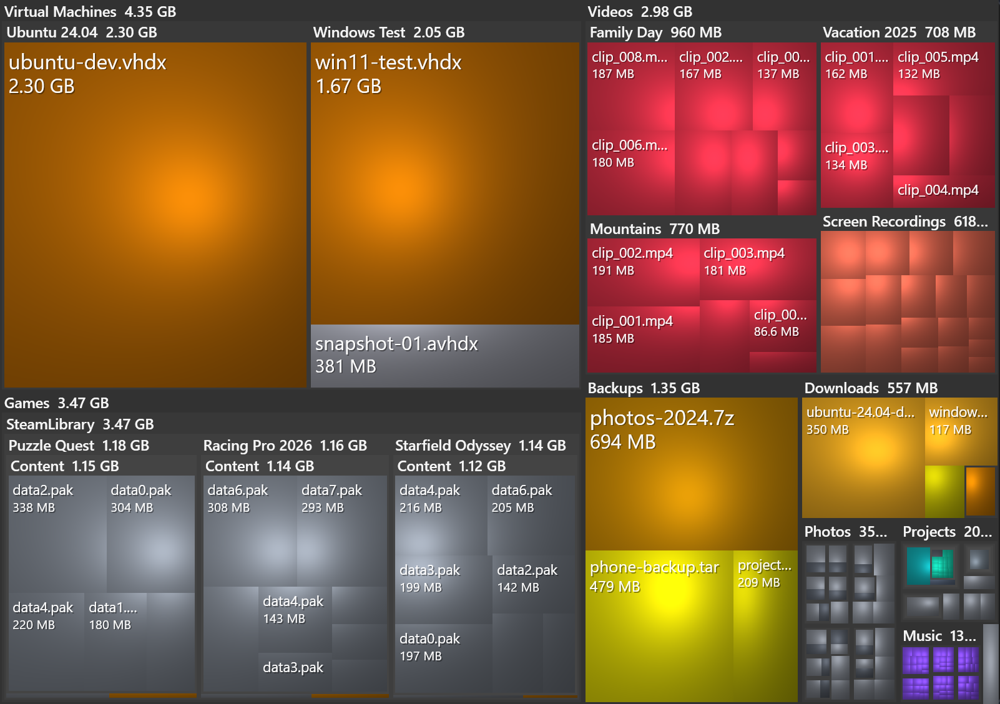
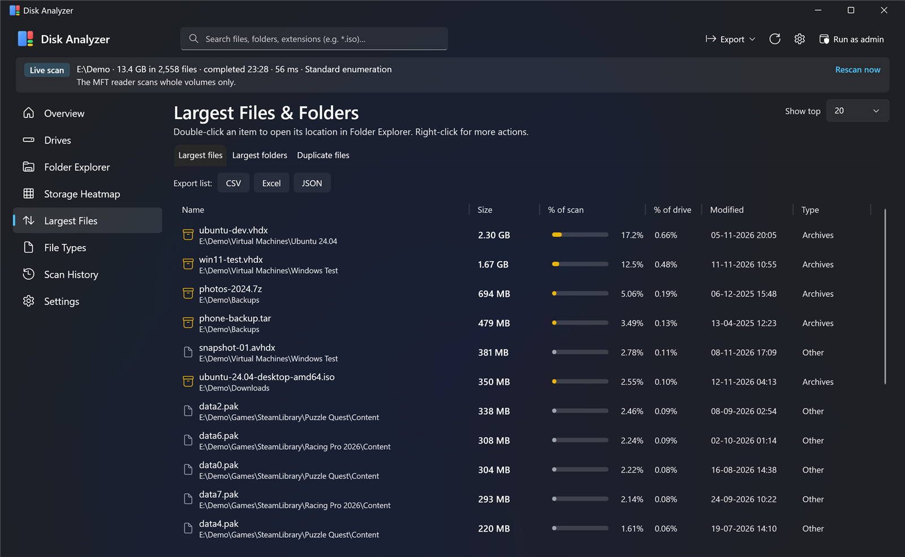

# Disk Analyzer

[](https://github.com/tinkubhanu216/disk-analyzer/releases/latest)
[](https://github.com/tinkubhanu216/disk-analyzer/actions/workflows/build.yml)
[](LICENSE)


**See exactly what is filling up your disk.** Disk Analyzer scans a drive or folder in seconds and shows where the space goes, in a folder explorer and in a zoomable heatmap where bigger files are bigger tiles.

It is free and open source, and **read-only**: it never changes, moves or deletes your files.



**[Download](#download)** · **[Getting started](#getting-started)** · **[Features](#features)** · **[Screenshots](#screenshots)** · **[FAQ](#faq)** · **[For developers](#for-developers)**

---

## Download

[-0067C0?style=for-the-badge&logo=windows)](https://github.com/tinkubhanu216/disk-analyzer/releases/latest/download/DiskAnalyzer-Setup-x64.msi)
[-555555?style=for-the-badge&logo=windows)](https://github.com/tinkubhanu216/disk-analyzer/releases/latest/download/DiskAnalyzer-portable-x64.zip)

**Requirements:** Windows 10 (1809 or later) or Windows 11, 64-bit. Nothing else to install.

| | How to install | How to remove |
|---|---|---|
| **Installer (.msi)** | Run it and follow the wizard. Adds a Start menu shortcut; new versions upgrade in place. | **Settings → Apps** → Disk Analyzer → Uninstall |
| **Portable (.zip)** | Extract anywhere (even a USB stick) and run `DiskAnalyzer.exe`. | Delete the folder |

> **"Windows protected your PC"?** The downloads are not code-signed yet, so Windows SmartScreen shows an "unknown publisher" warning. Click **More info → Run anyway**. Every release is built automatically from this repository's source by [GitHub Actions](https://github.com/tinkubhanu216/disk-analyzer/actions).

<details>
<summary>Verify your download (optional)</summary>

Each release includes [`SHA256SUMS.txt`](https://github.com/tinkubhanu216/disk-analyzer/releases/latest/download/SHA256SUMS.txt). In PowerShell, run the following and compare the result with the line for that file:

```powershell
Get-FileHash .\DiskAnalyzer-Setup-x64.msi -Algorithm SHA256
```

</details>

Older versions and release notes: [Releases page](https://github.com/tinkubhanu216/disk-analyzer/releases).

## Getting started

1. **Open Disk Analyzer.** The start page lists your drives with their used and free space.
2. **Click _Scan drive_** on a drive card, or **_Scan a specific folder…_** to scan only one folder.
3. **Read the Overview.** It shows the total size, the biggest folders and files, and the space used by each file type.
4. **Click _Visualize Storage_** to open the heatmap. Each rectangle is a file or folder, sized by how much space it uses. Click a folder to zoom in, scroll to zoom out, and hover over a tile for details.
5. **Find what to clean up** with **Largest Files**, **File Types** or the search box (try `*.iso` or `*.mp4`). Right-click any item to open its location in Windows Explorer and act on it there; Disk Analyzer itself never deletes anything.

**Tip:** for whole drives, use **Run as admin** (top right). It lets Disk Analyzer read the NTFS file table directly, which scanned a 2-million-file system drive in about **3 seconds** in our tests.

## Features

| | |
|---|---|
| 💽 **Drives at a glance** | Every drive with its type (SSD, HDD, USB, network), file system, capacity and how full it is. |
| ⚡ **Fast scanning** | Scans in parallel; about 1 million files in ~2 seconds on an SSD (repeat scan), or a whole drive in seconds when run as administrator. See [benchmarks](docs/BENCHMARKS.md). |
| 🗺️ **Storage heatmap** | Zoomable treemap; color by file type, file age or size; find items on the map; highlight the largest files and folders. |
| 📁 **Folder explorer** | Folder tree with sizes and percentages; sort by size, name, file count or date; filter by name, extension, type or minimum size. |
| 🏆 **Largest files & duplicates** | Top 20 to 1,000 largest files and folders, and a duplicate file finder that compares file contents, not just names. |
| 🧩 **File types** | Space used by documents, images, videos, audio, apps, archives, code and more, with the top extensions. |
| 🔎 **Instant search** | Search the scan results by name, wildcard, extension, type or size; nothing is rescanned. |
| 🕓 **Scan history** | Reopen earlier scans without rescanning, and compare two scans to see new and deleted files and folders that grew or shrank. |
| 📤 **Export** | Save results as CSV, Excel (.xlsx) or JSON: everything, folders only, or the top items. |
| 🛡️ **Safe by design** | Read-only, works without administrator rights, no internet connection, no telemetry. Dark and light themes. |

## Screenshots

**Overview**: total size, file and folder counts, the biggest folders, a mini heatmap, the largest files and a file-type breakdown.


**Storage Heatmap**: the full heatmap with display options, the current folder and a color legend.


<details>
<summary><b>More screenshots</b>: Folder Explorer, Largest Files, File Types</summary>

**Folder Explorer**: folder tree, sizes and share of the parent folder, filters and a details panel.


**Largest Files & Folders**: ranked lists with export buttons, plus a duplicate finder tab.



**File Types**: how space splits across file categories and which extensions use the most.


</details>

<sub>Click any screenshot to see it at full size. The screenshots use generated demo data, not a real drive.</sub>

## FAQ

<details>
<summary><b>Is it safe? Can it delete my files?</b></summary>

No, it cannot. Disk Analyzer only reads file and folder information. Scanning, searching, comparing and exporting never modify, move or delete anything on your drives. To clean up, right-click an item to open its location in Windows Explorer, and delete files there yourself.
</details>

<details>
<summary><b>Why doesn't the scanned total match the "used space" Windows shows?</b></summary>

Windows' used space also includes things that aren't ordinary files: NTFS metadata (the file table and journal), System Restore points, reserved space, and folders your account can't read. Some files also take more or less space on disk than their size suggests: hard links are stored once but appear under several names, compressed and sparse files use less space, and OneDrive "online-only" files use almost none. Disk Analyzer shows both **Size** and **Size on disk**, and the Overview page compares the scanned total with what Windows reports.
</details>

<details>
<summary><b>Do I need to run it as administrator?</b></summary>

No. It works with normal rights. Running as administrator makes whole-drive scans of NTFS drives much faster and lets it see a few protected system folders.
</details>

<details>
<summary><b>Does it send any data anywhere?</b></summary>

No. It makes no network connections. Settings, logs and scan history stay on your PC in `%LOCALAPPDATA%\DiskAnalyzer`. See the [privacy policy](#privacy-policy).
</details>

<details>
<summary><b>Something went wrong. Where are the logs?</b></summary>

In `%LOCALAPPDATA%\DiskAnalyzer\logs`, or use **Settings → Open logs** in the app. Please [open an issue](https://github.com/tinkubhanu216/disk-analyzer/issues/new/choose) and attach the relevant part.
</details>

---

## For developers

Built with C# / .NET 10, WPF (Fluent theme) and MVVM, with SQLite for scan history and Serilog for logging.

### Build, test, run

Requires the .NET 10 SDK on Windows.

```powershell
dotnet build DiskAnalyzer.sln
dotnet test DiskAnalyzer.sln
dotnet run --project src/DiskAnalyzer.App
```

`./build.ps1` runs the full release pipeline: tests, a self-contained publish (`artifacts/publish/win-x64/DiskAnalyzer.exe`) and the WiX MSI (`artifacts/DiskAnalyzer-Setup-x64.msi`). Use `-Runtime win-arm64` for an Arm64 build.

**Command line:**

```
DiskAnalyzer.exe [<folder>] [--scan <path>] [--page overview|drives|explorer|heatmap|largest|types|history|settings] [--verbose]
```

### How it works

- **Scanner:** a fixed pool of `System.IO.Enumeration` workers feeding a single writer through a bounded channel (no task per folder). An optional NTFS MFT reader is used when elevated. Junctions and symlinks are not followed by default, hard links can be counted once, and access-denied folders are flagged.
- **Data model:** a compact struct-of-arrays tree (~107 bytes per entry); folder totals are computed in one linear pass.
- **Treemap:** squarified layout with cushion shading, rendered into a single bitmap, so 100k+ tiles stay responsive.

Details: [docs/ARCHITECTURE.md](docs/ARCHITECTURE.md) · Measured performance: [docs/BENCHMARKS.md](docs/BENCHMARKS.md)

```powershell
dotnet run -c Release --project tools/DiskAnalyzer.Benchmarks -- suite --data D:\BenchData
```

### Project layout

| Project | Purpose |
|---|---|
| `src/DiskAnalyzer.Core` | Data model (`ScanTree`), interfaces, aggregation, analysis, search, comparison, duplicates |
| `src/DiskAnalyzer.Scanner` | Drive discovery, standard and MFT scan providers, scan orchestrator |
| `src/DiskAnalyzer.Visualization` | Squarified layout, cushion renderer, `TreemapControl` |
| `src/DiskAnalyzer.Infrastructure` | SQLite history, CSV/XLSX/JSON export, logging, settings |
| `src/DiskAnalyzer.App` | WPF shell, views, view models |
| `tests/*` | xUnit tests, including real-filesystem tests for junctions, hard links, access denied and long paths |
| `tools/` | Benchmarks, demo-data and screenshot scripts |
| `installer/` | WiX MSI project |
| `packaging/winget/` | winget manifests |

Contributions are welcome. See [CONTRIBUTING.md](CONTRIBUTING.md). To report a security issue, see [SECURITY.md](SECURITY.md).

## Code signing policy

Free code signing provided by [SignPath.io](https://about.signpath.io), certificate by [SignPath Foundation](https://signpath.org).
(Signing is being set up; releases made before it is active are unsigned. See [docs/CODE_SIGNING.md](docs/CODE_SIGNING.md).)

- **Committers and reviewers:** [Bhanuprasad Thandra](https://github.com/tinkubhanu216)
- **Approvers:** [Bhanuprasad Thandra](https://github.com/tinkubhanu216)

Only release binaries built by GitHub Actions from this repository's source are signed.

## Privacy policy

This program will not transfer any information to other networked systems unless specifically requested by the user
or the person installing or operating it. All settings, logs and scan history stay on the local computer in
`%LOCALAPPDATA%\DiskAnalyzer`.

## License

[MIT](LICENSE) © 2026 Bhanuprasad Thandra. Third-party components are listed in [THIRD-PARTY-NOTICES.txt](THIRD-PARTY-NOTICES.txt).
