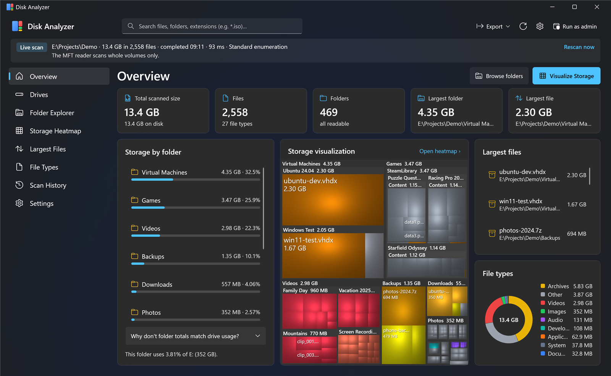
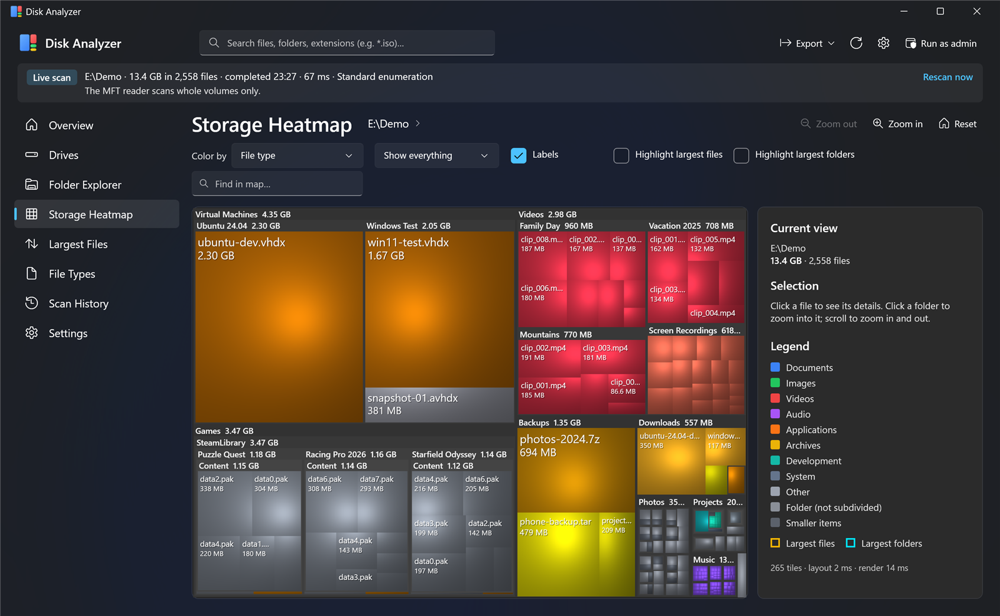
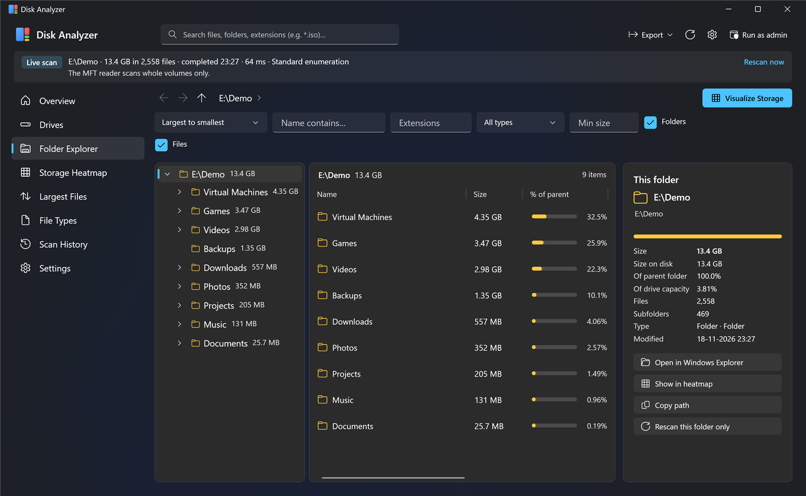
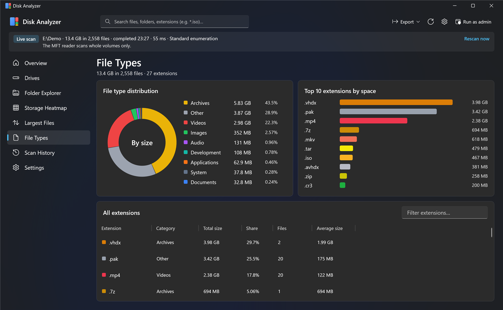

# Disk Analyzer

[](../../actions/workflows/build.yml) [](LICENSE)

A fast, read-only Windows disk space analyzer with an interactive treemap heatmap.
Built with C# / .NET 10 / WPF (Fluent theme), MVVM, SQLite and Serilog.

- **Drive overview**: every drive with type (SSD/HDD/USB/network), file system, capacity, used/free and utilization.
- **Fast scanning**: a bounded, multithreaded `System.IO.Enumeration` scanner, plus an optional NTFS Master File Table reader when the app runs as administrator. It never needs elevation to launch.
- **Folder Explorer**: lazy folder tree, breadcrumbs, back/forward, sorting (size, name, file count, modified) and filters (name/wildcard, extension, type, minimum size).
- **Storage Heatmap**: a squarified, cushion-shaded treemap rendered into a single bitmap, so it stays responsive with 100k+ tiles. Click to zoom, scroll to zoom in or out, search, highlight the largest items, and color by file type, age or size.
- **Largest files and folders**, **file types** (top extensions, category distribution) and **duplicate finder** (size → partial hash → SHA-256).
- **Instant search** over the in-memory index (debounced, wildcards, filters). Nothing is rescanned.
- **Scan history** in SQLite: reopen past scans, compare two scans (new/deleted files, folders that grew or shrank). Every result is labelled *Live*, *Cached* or *Historical*.
- **Export** to CSV, Excel (.xlsx) or JSON: all items, folders only, or the top N files/folders.
- **Dark and light themes**, high-DPI aware, long-path aware.

Nothing on your drives is modified by scanning, searching, comparing or exporting.

## Download

[-0067C0?style=for-the-badge&logo=windows)](https://github.com/tinkubhanu216/disk-analyzer/releases/latest/download/DiskAnalyzer-Setup-x64.msi)
[-555555?style=for-the-badge&logo=windows)](https://github.com/tinkubhanu216/disk-analyzer/releases/latest/download/DiskAnalyzer-portable-x64.zip)

The buttons always download the latest version. Older versions and release notes are on the [Releases page](https://github.com/tinkubhanu216/disk-analyzer/releases).

**Requirements:** Windows 10 (1809 or later) or Windows 11, 64-bit. Nothing else is needed: the .NET runtime is included.

**Installer (.msi):** run `DiskAnalyzer-Setup-x64.msi` and follow the wizard. It adds a Start menu shortcut, and newer versions upgrade in place. To remove it, use **Settings → Apps**.

**Portable (.zip):** extract anywhere (for example a USB stick) and run `DiskAnalyzer.exe`. Nothing is installed.

> **"Windows protected your PC"?** The downloads are not yet code-signed, so Windows SmartScreen warns about an unknown publisher. Click **More info → Run anyway**. Every release is built from this repository's source by [GitHub Actions](../../actions); you can check the download with the checksums below.

**Verify your download (optional):** each release includes `SHA256SUMS.txt`. In PowerShell:

```powershell
Get-FileHash .\DiskAnalyzer-Setup-x64.msi -Algorithm SHA256
```

The hash should match the line for that file in [SHA256SUMS.txt](https://github.com/tinkubhanu216/disk-analyzer/releases/latest/download/SHA256SUMS.txt).

Administrator rights are not needed. To use the much faster NTFS Master File Table scan for whole drives, right-click the app and choose **Run as administrator**, or use the **Run as admin** button inside the app.

## Screenshots

**Overview**: headline numbers, storage by folder, a live treemap, the largest files and the file-type breakdown.



**Storage Heatmap**: a nested, cushion-shaded treemap. Click a folder to zoom in, scroll to zoom out, and hover for details.



<details>
<summary><b>More screenshots</b>: Folder Explorer, Largest Files, File Types</summary>

**Folder Explorer**: lazy folder tree, breadcrumbs, sorting and filters, with a details panel.



**Largest Files & Folders**: ranked lists with export and a duplicate finder.


**File Types**: category distribution and the extensions using the most space.



</details>

<sub>Screenshots show generated demo data (`tools/make-demo-data.ps1`); regenerate them with `tools/take-screenshots.ps1`.</sub>

## Requirements

- Windows 10 1809+ or Windows 11, x64 (an arm64 build is possible via `build.ps1 -Runtime win-arm64`)
- To build: .NET 10 SDK

## Build, test, run

```powershell
dotnet build DiskAnalyzer.sln
dotnet test DiskAnalyzer.sln
dotnet run --project src/DiskAnalyzer.App
```

Release package (tests, self-contained publish, MSI installer):

```powershell
./build.ps1
```

Outputs:
- `artifacts/publish/win-x64/DiskAnalyzer.exe`: self-contained executable (no .NET install needed)
- `artifacts/DiskAnalyzer-Setup-x64.msi`: Windows installer (WiX 6, per-machine, Start menu shortcut, upgrades in place)

Before distributing, code-sign the executable and the MSI so Windows shows the verified publisher.

### Command line

```
DiskAnalyzer.exe [<folder>] [--scan <path>] [--page overview|drives|explorer|heatmap|largest|types|history|settings] [--verbose]
```

## Benchmarks

```powershell
dotnet run -c Release --project tools/DiskAnalyzer.Benchmarks -- suite --data D:\BenchData
dotnet run -c Release --project tools/DiskAnalyzer.Benchmarks -- scan --root C:\Users --runs 3
```

`suite` generates trees of 100k, 500k and 1M files, a 250-level deep tree, 200k files in one folder, and large sparse files, then deletes them.
Results measured on the development machine are in [docs/BENCHMARKS.md](docs/BENCHMARKS.md).

## Project layout

| Project | Purpose |
|---|---|
| `src/DiskAnalyzer.Core` | Data model (`ScanTree`), interfaces, aggregation, analysis, search, comparison, duplicates |
| `src/DiskAnalyzer.Scanner` | Drive discovery, standard + MFT scan providers, scan orchestrator |
| `src/DiskAnalyzer.Visualization` | Squarified layout, cushion renderer, `TreemapControl` |
| `src/DiskAnalyzer.Infrastructure` | SQLite history/cache, CSV/XLSX/JSON export, Serilog, settings |
| `src/DiskAnalyzer.App` | WPF shell, views, view models |
| `tests/*` | xUnit tests (aggregation, percentages, treemap geometry, extension grouping, cancellation, access denied, junctions, hard links, long paths, empty and very large folders, duplicates, history, export) |
| `tools/DiskAnalyzer.Benchmarks` | Benchmark utility |
| `installer/DiskAnalyzer.Installer` | WiX MSI project |

The design rationale, including the data model, scanning pipeline, MFT handling, accuracy rules and persistence, is in [docs/ARCHITECTURE.md](docs/ARCHITECTURE.md).

## Data, logs and privacy

Settings, logs (14 days, rolling) and scan history live in `%LOCALAPPDATA%\DiskAnalyzer`. Nothing is sent over the network.

## License

[MIT](LICENSE) © 2026 Bhanuprasad Thandra. Third-party components are listed in [THIRD-PARTY-NOTICES.txt](THIRD-PARTY-NOTICES.txt).

Contributions are welcome — see [CONTRIBUTING.md](CONTRIBUTING.md). To report a security issue, see [SECURITY.md](SECURITY.md).

## Why folder totals differ from "used space"

Windows' used space includes NTFS metadata (MFT, journal, security descriptors), shadow copies, reserved space, and files the current user cannot read. Hard links are stored once but appear under several names. Compression and sparse files make the logical size differ from the size on disk, and cloud placeholders take little local space. Disk Analyzer shows both **Size** (logical) and **Size on disk**, and compares the scanned total with Windows' used space on the Overview page.
